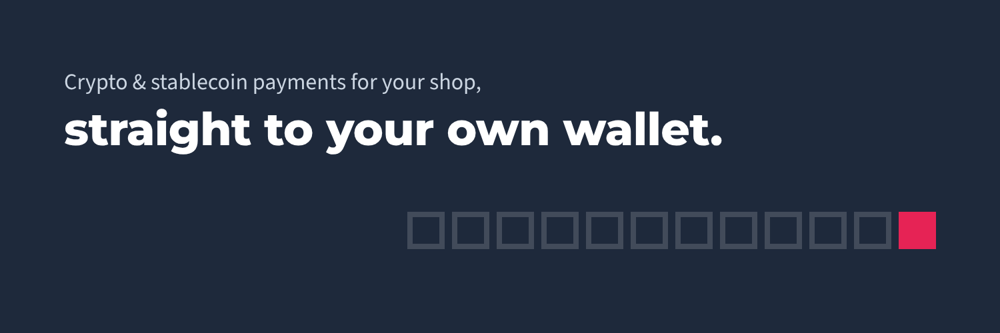

## Hi, I'm Alexander 👋

**Payments engineer. Creator of [LedgerDirect](https://ledger-direct.com).**

I build the merchant side of direct payments: the part that decides when an order counts as paid, and makes sure it goes *ka-ching* in the merchant's own wallet, not in somebody else's account.

---

### ⚡ LedgerDirect

**An open contract for merchant payments without middlemen, and I ship the implementations too.**
LedgerDirect works out of the box, just enter you wallet address to paid. No custodian, no secrets, no keys.

- 🛒 **Shop plugins:** [Shopware 6](https://github.com/ledger-direct/ledger-direct-shopware6) · [WooCommerce](https://github.com/ledger-direct/ledger-direct-woocommerce) · [Magento 2](https://github.com/ledger-direct/ledger-direct-magento2) · [PrestaShop](https://github.com/ledger-direct/ledger-direct-prestashop)
- 🌐 **Networks:** XRP Ledger (XRP, RLUSD, USDC) · Xahau (XAH) · Stellar and Interledger in the works
- 🧱 **Under the hood:** one PHP core, one payment page for every shop, and an end-to-end harness that runs 15 payment cases

**Try it in five minutes.** Testnet, no account, no real money:

```bash
git clone https://github.com/ledger-direct/ledger-direct-shopware6
cd ledger-direct-shopware6/dev/try
docker compose up -d --wait    # then open http://localhost:8091
```

### 🧰 Libraries I maintain

- **[xrpl-php](https://github.com/AlexanderBuzz/xrpl-php)**: XRP Ledger SDK for PHP
- **[xahau-php](https://github.com/AlexanderBuzz/xahau-php)**: Xahau client for PHP, built on xrpl-php
- **[xrpl-ruby](https://github.com/AlexanderBuzz/xrpl-ruby)**: XRP Ledger SDK for Ruby

---

📍 Fulda, Germany · 🌐 [ledger-direct.com](https://ledger-direct.com) · X [@LedgerDirect](https://x.com/LedgerDirect) · [LinkedIn](https://www.linkedin.com/in/alexanderbusse)
